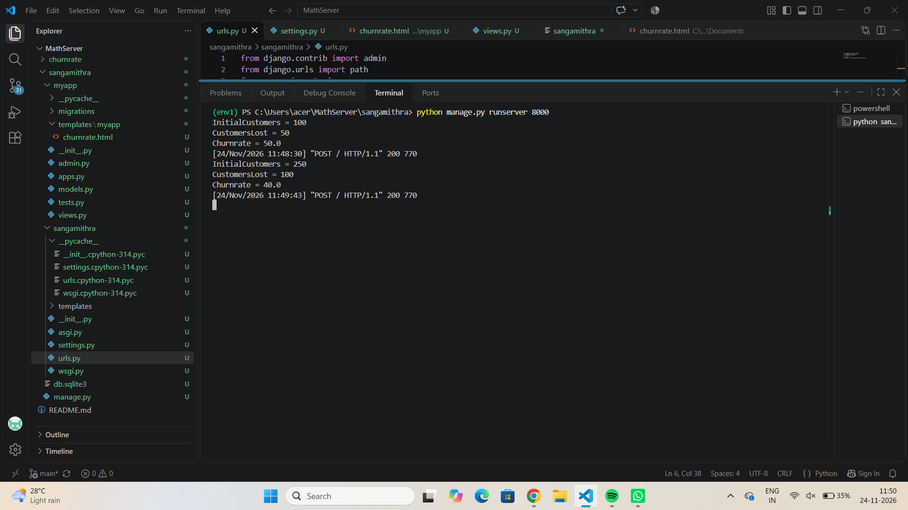

# Ex.03 Design a Website for Server Side Processing
## Date:14.11.26

## AIM:
To create a web page to calculate Churn Rate using server-side scripts.

## FORMULA:
Churn Rate = (CustLost / InitCust) * 100
<br> InitCust --> Initial Customers Count
<br> CustLost --> Customers Lost Count

## DESIGN STEPS:

### Step 1:
Clone the repository from GitHub.

### Step 2:
Create Django Admin project.

### Step 3:
Create a New App under the Django Admin project.

### Step 4:
Create a HTML file to implement form based input and output.

### Step 5:
Create python programs for views and urls to perform server side processing.

### Step 6:
Receive input values from the form using request.POST.get().

### Step 7:
Calculate the Result using the given formula.

### Step 8:
Display the calculated result in the server console.

### Step 9:
Render the result to the HTML template.

### Step 10:
Publish the website in Localhost.

## PROGRAM:
```
html program
<html>
    <head>
        <title>calculate</title>
    </head>
    <body>
       
          <h1>Sangamithra(26001739)</h1>
          <h2>Churnrate</h2>
          <form method ="POST">
            

              <label>InitialCustomers:</label>
              <input type ="number" name="InitialCustomers" value="ic"><br></br>

              <label>CustomersLost:</label>
              <input type  ="number" name="CustomersLost" value="cl"><br></br>
              <input type ="submit" value ="Calculate"><br></br>

              <label>Churnrate:</label>
              <input type = "number" value="Churnrate">
          </form>
    </body>
</html>

views 
from django.shortcuts import render

def Churnrate(request):
    ic =int(request.POST.get('InitialCustomers', '0'))
    cl = int(request.POST.get('CustomersLost', '0'))

    Churnrate=(cl/ic)*100 if request.method == 'POST' else 0

    print("InitialCustomers =", ic)
    print("CustomersLost =", cl)
    print("Churnrate =", Churnrate)
    return render(
        request,
        'myapp/churnrate.html',
        {'ic': ic, 'cl': cl, 'Churnrate':Churnrate}
    )

    urls 
    from django.contrib import admin
from django.urls import path
from myapp import views

urlpatterns = [
    path('', views.Churnrate, name='Churnrate'),
]
```


## OUTPUT - SERVER SIDE:



## OUTPUT - WEBPAGE:
.png>)


## RESULT:
The the web page to calculate Churn Rate using server-side scripts is created successfully.
